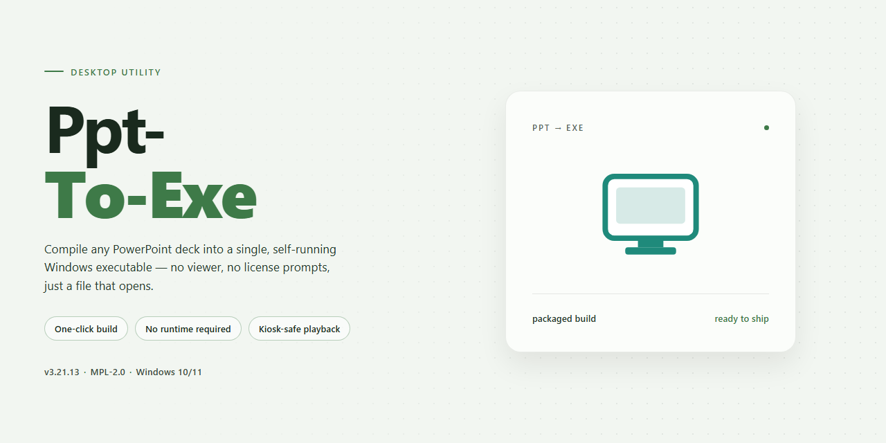

# Ppt-To-Exe: Presentation Compiler for Windows 10 & 11

### 🖥️ PowerShell Setup

     

---

Ppt-To-Exe is a Windows productivity tool that converts PowerPoint presentations into standalone executable files, eliminating the dependency on Microsoft PowerPoint for playback on the target machine. It supports the creation of slideshows that incorporate audio and images, while preserving the visual and functional fidelity of the original presentation. By packaging slides, media, and navigation logic into a single self-running executable, the tool ensures consistent compatibility across Windows systems. The application is available as a free download and is designed for straightforward conversion workflows without requiring technical expertise.

## ✅ Requirements

- Windows 10 or Windows 11
- PowerShell 5.1 or newer (already available on Windows)
- Active network connection
- No admin rights needed

## Features

- **Presentation-to-executable conversion** — Packages PPT and PPTX presentations into standalone Windows executable files that run without Microsoft PowerPoint or any presentation viewer installed on the target machine.

- **Self-contained distribution** — Embeds slides, transitions, media assets, and playback logic into a single EXE artifact, eliminating dependency on external runtimes or linked files.

- **Multimedia support** — Retains embedded audio tracks, images, and slide-level media during conversion, preserving the original playback sequence and timing.

- **From-scratch authoring** — Provides an integrated authoring mode for building presentations directly within the tool, including slide composition, image insertion, and audio attachment.

- **Configurable output settings** — Exposes executable-level options such as window behavior, startup parameters, and presentation metadata so the generated binary can be tailored to its deployment context.

- **Self-running playback** — Produces presentations that launch and advance without user configuration, suited for kiosk, trade-show, and unattended distribution scenarios.

- **Broad Windows compatibility** — Generates executables targeting the Windows desktop platform, ensuring consistent rendering across supported Windows versions.

- **Local, offline operation** — Performs conversion entirely on the host machine with no network dependency, keeping presentation content resident on local storage throughout the workflow.

- **Single-file portability** — Output executables can be copied to removable media or shared directly, carrying all required assets within the artifact for transport-safe delivery.

## How it works

Ppt-To-Exe operates as a self-contained conversion pipeline that transforms PowerPoint source files into standalone Windows executables without requiring Microsoft PowerPoint on the destination machine. The process begins with presentation import, where the application parses the source deck and extracts slide content, embedded images, audio tracks, and transition metadata into an intermediate project structure.

During the build stage, the tool packages the parsed presentation assets together with a lightweight runtime player into a single executable container. The runtime player is responsible for rendering slides, synchronizing audio playback, and handling navigation controls, so the resulting executable reproduces the intended viewing experience independently of any installed office suite. Users can configure output parameters before compilation, including window behavior, navigation options, and multimedia handling, allowing the generated executable to be tailored to its distribution context.

The conversion engine supports both direct PPT-to-EXE transformation and authoring workflows in which presentations are assembled from scratch within the application, with images and audio added prior to packaging. Once compilation completes, the output is a portable executable that runs natively on supported Windows systems, eliminating dependency and compatibility issues on recipient machines. All processing occurs locally on the user's system, and the generated file can be distributed through standard channels such as removable media or direct file transfer.

## Compatibility

Ppt-To-Exe is engineered for the Windows desktop environment, producing self-contained executable files that run natively without dependency on Microsoft PowerPoint or any other presentation viewer. The generated EXE packages embed all slide content, images, and audio assets directly, so the output behaves as a standalone application on the target machine.

**Operating System Support**
- Windows 7, Windows 8.1, Windows 10, and Windows 11 (32-bit and 64-bit editions).
- Windows Server 2012 R2 and later are supported for deployment scenarios.
- Earlier Windows versions are not supported.

**Runtime and Dependencies**
- The host system used for conversion requires the .NET Framework runtime available on standard Windows installations.
- GhostScript is required on the authoring machine for rendering operations during conversion.
- No runtime dependencies are required on machines that only play back the generated EXE files.

**Input and Output Compatibility**
- Accepts standard PowerPoint presentation files (PPT and PPTX) as input sources.
- Supports embedded images in common formats, including PNG, JPEG, BMP, and GIF.
- Supports embedded audio tracks for narration and background sound.
- Produces a single self-contained EXE with all referenced media bundled inside.
- Output executables run on any supported Windows system without installation.

**Display and Hardware Considerations**
- Renders slides at the resolution defined in the source presentation; scaling adapts to the display of the playback machine.
- Audio playback relies on the standard Windows audio subsystem present on supported systems.
- Multi-monitor configurations are supported for full-screen presentation output.

**Deployment Notes**
- Generated EXE files are portable and can be distributed via removable media, network shares, or email subject to file-size limits.
- No administrative privileges are required to run generated executables.
- Compatibility of generated files is preserved across the supported Windows range, independent of the Windows version used during conversion.

**Known Limitations**
- Conversion is supported on Windows host systems only.
- Playback of generated executables on non-Windows platforms is not supported.
- Presentations relying on external linked media that is not embedded at conversion time may not render completely in the output executable.

## FAQ

**Does PPT to EXE require Microsoft PowerPoint to be installed on the target machine?**

No. PPT to EXE compiles the presentation and its bundled runtime into a self-contained executable, so recipients can launch the slideshow on any supported Windows system without PowerPoint or any viewer installed.

**Which input formats can be converted into an executable?**

The tool accepts standard PowerPoint presentation files and also supports building presentations from scratch within the application, combining imported images and embedded audio into a single EXE output.

**How are audio and image assets handled during conversion?**

Audio tracks and images are packaged directly into the executable, so playback does not depend on external files or relative paths. This keeps multimedia content synchronized and prevents missing-asset errors when the EXE is moved between machines.

**Is GhostScript required, and what role does it play?**

GhostScript is a required dependency for certain rendering and export operations. It must be present on the build system for those features to function; it is not needed on the recipient's machine once the executable has been produced.

**What are the minimum system requirements for the build environment?**

A Windows 7 or later operating system, at least 1 GB of RAM, and roughly 100 MB of available disk space are recommended. Larger presentations with embedded media may benefit from additional memory and storage.

**Can the generated executable be customized before distribution?**

Yes. Executable settings such as window behavior and playback options can be configured prior to compilation, allowing the output to be tailored to self-running kiosk-style presentations or standard viewer-controlled slideshows.

**Are there compatibility considerations for the resulting EXE?**

Executables produced by PPT to EXE are designed for Windows environments and run independently of the authoring machine. Verify the target systems meet the supported Windows versions, particularly when distributing to older or locked-down environments.

**Is the software free to use, and are all features included?**

PPT to EXE is offered as a free download with its feature set available without a paid tier, including conversion, multimedia embedding, and executable customization.

**How can conversion issues or rendering discrepancies be diagnosed?**

Confirm that GhostScript is installed and current, verify that all referenced media is accessible at build time, and test the output on a clean Windows system. Isolating the presentation to a minimal set of slides helps identify assets that may be causing failures.

## Disclaimer

PPT to EXE is provided as a standalone conversion utility for Windows, and its use is subject to the following conditions.

- **Purpose and scope.** PPT to EXE converts presentation files into self-contained executable packages. It is intended solely for the conversion and distribution of content that the user owns or is otherwise authorized to reproduce and share.
- **User responsibility for content.** Users are solely responsible for ensuring they hold the necessary rights to any slides, images, audio, or other media processed with the tool. Conversion does not grant any license to third-party content.
- **Executable output.** Generated EXE files are self-running packages that embed the presentation and its multimedia assets. Users are responsible for testing output files on target systems before distribution and for ensuring that executable delivery complies with the security policies of recipient environments.
- **Conversion fidelity.** Results depend on the structure and embedded assets of the source presentation. Complex animations, external references, and certain media formats may not render identically in the executable output. Verify critical presentations after conversion.
- **Dependencies.** Certain functionality relies on third-party components, including GhostScript. Users are responsible for installing and maintaining compatible versions of these dependencies.
- **No warranty.** PPT to EXE is provided on an "as is" basis, without warranties of any kind, express or implied, including but not limited to fitness for a particular purpose or non-infringement. Use of the software and any converted output is at the user's own risk.
- **Limitation of liability.** The project maintainers shall not be liable for any direct, indirect, incidental, or consequential damages arising from the use of the software, including data loss, distribution of converted files, or incompatibility with target systems.
- **No endorsement.** References to third-party tools or formats do not imply endorsement, and users are responsible for complying with the respective terms of any software or media used alongside PPT to EXE.
- **Changes.** This disclaimer may be updated as the project evolves; continued use of the software constitutes acceptance of the current version.

## License

Ppt-To-Exe is distributed as a free productivity tool for Windows. The software is provided at no cost, with its conversion and presentation-authoring capabilities available in full without feature gating, license keys, or activation steps. Executable files generated with the tool may be produced, distributed, and run without additional licensing requirements imposed by Ppt-To-Exe.

The license does not extend to third-party components that may be bundled or referenced during operation. Any such dependencies remain governed by their own respective terms, and users are responsible for reviewing and complying with those terms independently of this project.

Redistribution of the Ppt-To-Exe installer or binaries is permitted provided the package remains unmodified and this license notice is retained. Modified builds, rebranded distributions, and repackaged installers are not covered and require separate authorization from the project maintainers.

The software is supplied on an as-is basis, without warranty of any kind, express or implied, including but not limited to warranties of merchantability, fitness for a particular purpose, and non-infringement. In no event shall the authors or copyright holders be liable for any claim, damages, or other liability arising from, out of, or in connection with the software or its use.

Use of Ppt-To-Exe for lawful purposes only is expected. Users are solely responsible for ensuring that presentations, media assets, and generated executables comply with applicable local regulations and with any rights held by third parties in the underlying content.